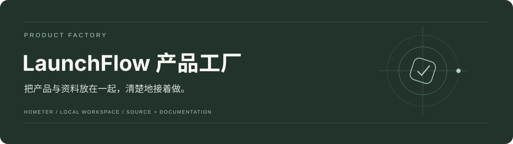
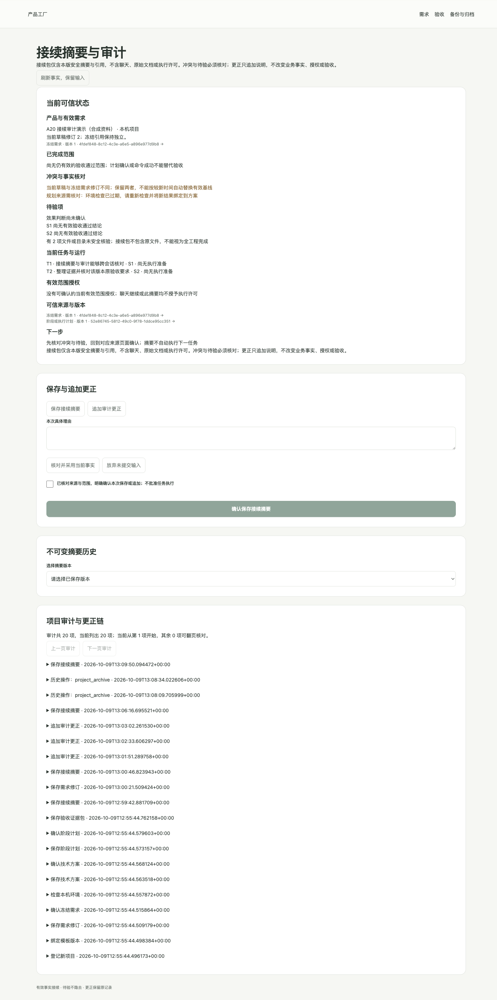

<div align="center">



# 产品工厂

**把产品与资料放在一起，清楚地接着做。**

[快速开始](#快速开始) · [配置说明](docs/配置说明.md) · [文档导航](docs/README.md) · [项目状态](docs/项目状态.md)

</div>

## 项目介绍

给本机单人管理多个产品的研发工作台。记录需求与基线，组织规划、执行准备、产物、验证、预算和接续事实；所有确认与历史都可追溯。

## 界面预览



实际 A20 接续与审计页面，来自本地合成工程演示。当前无真实模型效果验收，不以页面上的历史记录代替新的授权或通过。

## 核心功能

- 产品与需求：新建或只读接入目录、需求修订、问题确认、基线与阶段规划。
- 受控执行：补丁预览与安全写入；有限 Python 语法、JSON 和静态页面配方，记录暂停、取消与恢复。
- 验证与交付：上下文资产、工程记录、样例评测、证据包、闸门、缺陷影响和产物版本。
- 长期管理：提供方能力、成本预算、模板版本、备份归档、接续摘要与追加审计更正。

## 快速开始

准备 Python 3.12、Node.js 22；现有运行入口用于 macOS / Linux 的本机单用户。 下列命令适用于 macOS / Linux。先安装依赖：

```bash
git clone https://github.com/Hometer/product-factory.git
cd product-factory
python3.12 -m venv .venv
.venv/bin/python -m pip install -r backend/requirements.txt
npm --prefix frontend ci
npm --prefix frontend run build
```

启动服务：

```bash
.venv/bin/python scripts/run_local.py --no-browser
```

打开 <http://127.0.0.1:3000>；API 文档在 <http://127.0.0.1:8765/docs>。按 `Control+C` 停止对应服务。

## 配置说明

启动入口自动创建本机访问令牌，浏览器通过代理访问后端。默认模型关闭；如需启用，在提供方配置页填写自己的服务信息，再按项目明确外发授权与预算。根目录 `.env.example` 是配置提示，服务参数以进程环境变量和本机配置页为准。

详细参数、数据位置和工程检查见 [配置说明](docs/配置说明.md)。仓库不包含本机密钥、业务数据、依赖目录或运行缓存。

## 当前范围

A1—A20 有工程与证据记录，完整 FR01—FR24 首版及真实模型效果仍待验。不是通用自动研发执行器；任意项目 npm/pytest/shell、自动部署、多人或多 Agent 尚未作为已完成能力交付。界面内历史授权与通过不会自动继承。

以 [项目状态](docs/项目状态.md)、当前 PRD 与对应验收记录为准。历史测试与截图标明其范围，本次上传不新增产品验收结论。

## 文档与代码

`frontend/` 为 Next.js 工作台，`backend/` 为 FastAPI / SQLite / Alembic，`scripts/run_local.py` 管理本项目服务。

[文档导航](docs/README.md) · [当前需求](docs/PRD/%E4%BA%A7%E5%93%81%E5%B7%A5%E5%8E%82%E5%AE%8C%E6%95%B4%E4%BA%A7%E5%93%81%E9%9C%80%E6%B1%82%E6%96%87%E6%A1%A3.docx) · [配置与检查](docs/配置说明.md)

<details>
<summary>展开开发手册、需求与验收记录</summary>

- [需求与 PRD](docs/PRD/)
- [开发手册与操作说明](docs/手册/)
- [技术适配与阶段开发文档](docs/阶段文档/)
- [验收记录与实际界面证据](docs/evidence/)
- [历史首页与分期开发记录](docs/历史/开发记录.md)
- [本次仓库整理记录](docs/仓库整理记录.md)

</details>

## 许可与来源

保留原项目 [LICENSE](LICENSE) 与作者署名。项目由 AI 产品开发工具包起步；历史规则与必要文档保留，新增整理以实际实现为准。
